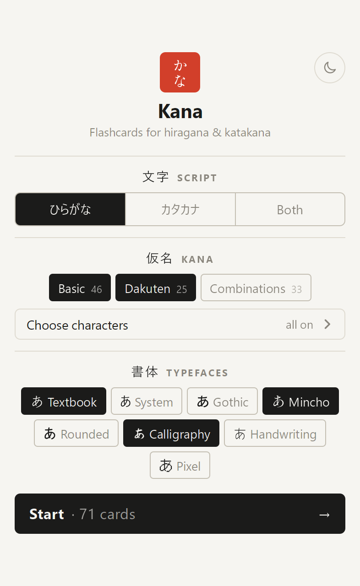
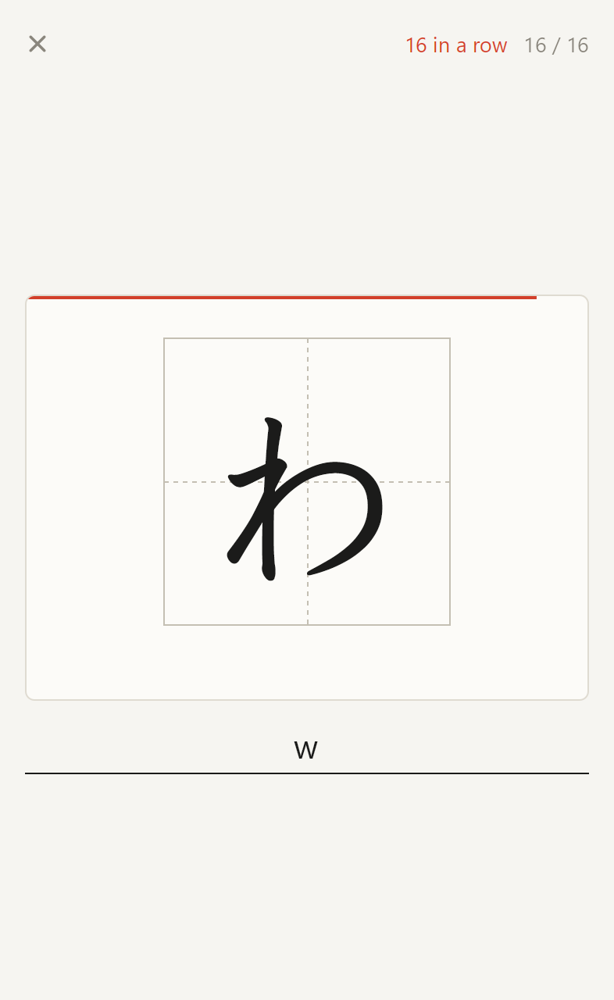

# Kana

A small flashcard app for practising Japanese hiragana and katakana. It runs entirely in the browser, with no backend, framework or build step, and starts instantly on a phone.

Made to my exact personal preferences using AI.

<p align="center">
  
  &nbsp;&nbsp;
  
</p>

## What it does

- Shows a kana in a large practice square. You type the romaji.
- A correct answer turns the card green right away, without pressing Enter. A wrong answer (Enter) or no answer within 5 seconds turns it orange and shows the right romaji.
- Cards come in random order, shuffled differently every time you press Start. There is no scoring pressure: you just keep practising, with a simple score and streak counter.
- Common romaji variants are accepted, such as `si`/`shi`, `tu`/`tsu`, `hu`/`fu` and `nn` for ん.

## Options

- **Script**: hiragana, katakana or both.
- **Kana**: basic (46), dakuten (25) and combinations such as きゃ (33).
- **Choose characters**: a gojūon table where each character cycles through *on → focus → off*. Focus characters appear three times as often. Whole rows (K, S, T…) can be toggled at once.
- **Typefaces**: each card is shown in a random typeface from your selection: Textbook (the default, similar to the Genki textbook), System, Gothic, Mincho, Rounded, Calligraphy, Handwriting and Pixel. This helps you recognise kana in different styles.
- **Light/dark mode**: light is the default.

Your choices are saved in the browser's local storage.

## Running and deploying

Open `index.html` directly, or serve the folder with any static file server. To deploy, copy the files and the `fonts/` folder to a web server. For example, with Caddy:

```
kana.example.com {
	root * /srv/kana
	encode zstd gzip
	header Cache-Control "no-cache"
	file_server
}
```

## Made with AI

This app was built entirely with AI ([Claude Code](https://claude.com/claude-code)): the code, styling and font selection, from a short description and iterative feedback.

## License

The app's code is licensed under the [MIT License](LICENSE). The fonts in `fonts/` are licensed separately under the SIL Open Font License 1.1; see [fonts/LICENSE.md](fonts/LICENSE.md).
